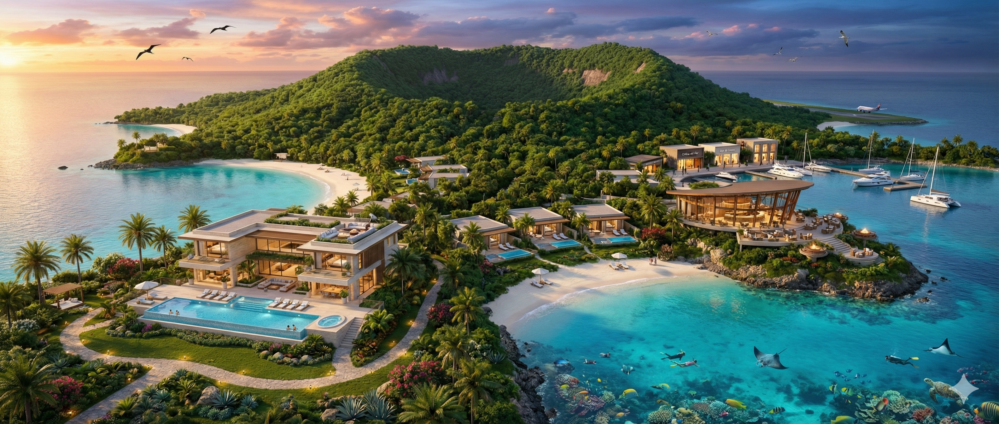
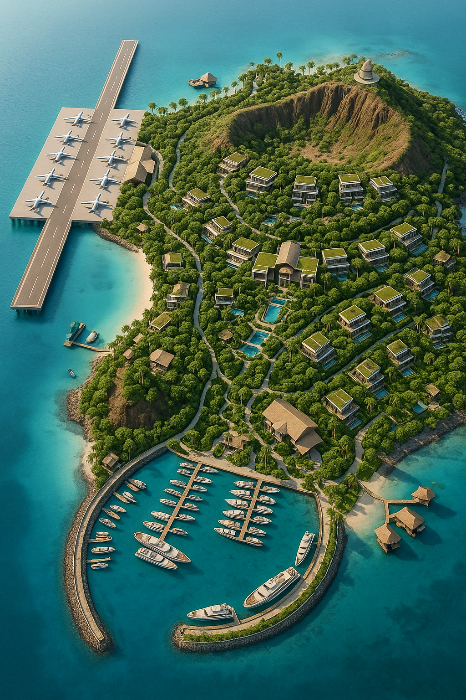
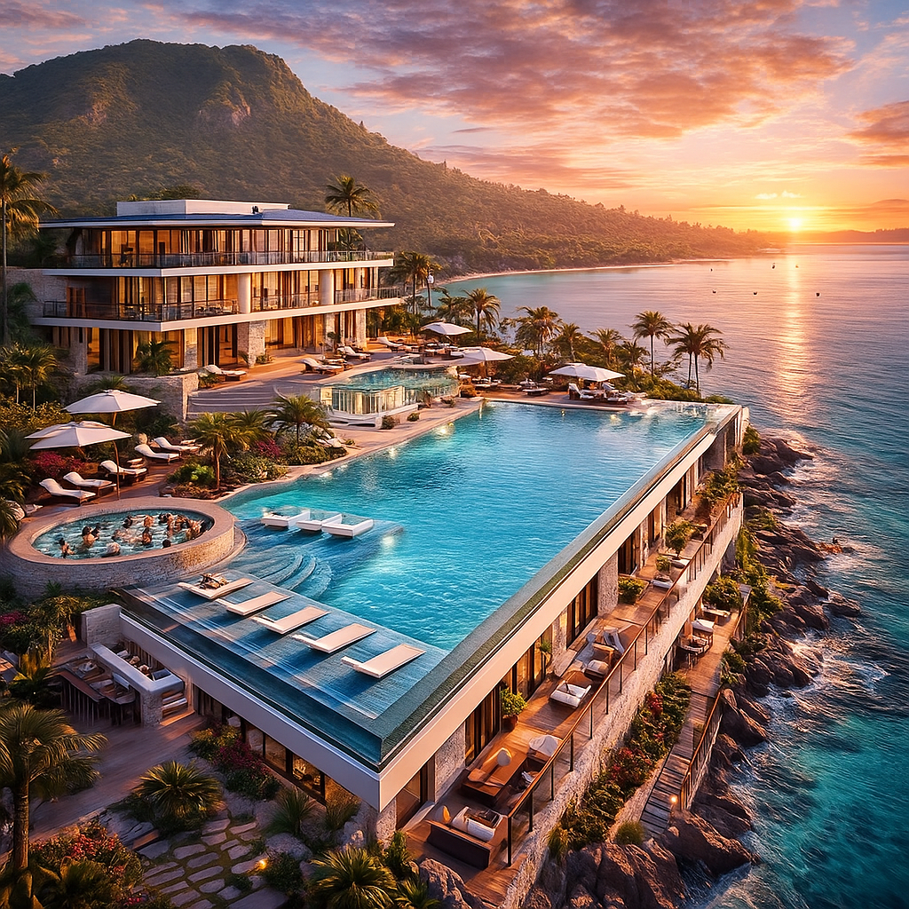
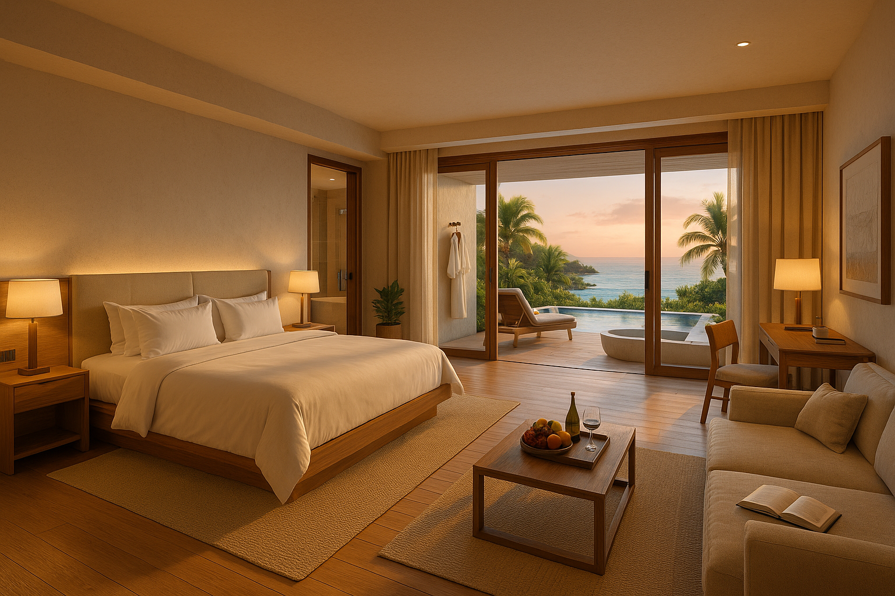
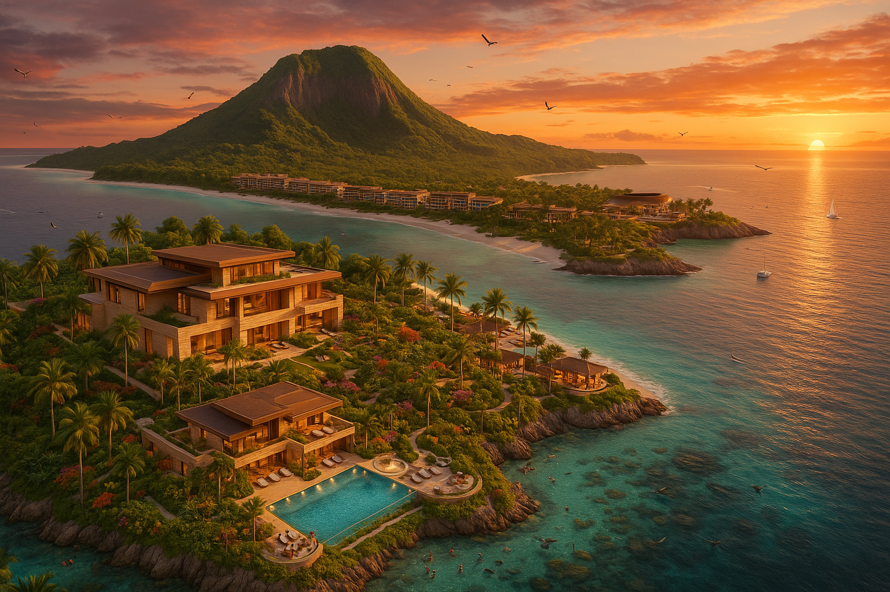

# ISLA · La Encantada

**Ver en vivo: [isla.capitaltorreon.com](https://isla.capitaltorreon.com)** · proyecciones privadas: [/proyecciones](https://isla.capitaltorreon.com/proyecciones) (con el login de CapitalTorreon)

Un mundo 3D persistente, calidad AAA, ambientado en una isla volcánica privada convertida en el mega-resort de lujo más cuidado que exista. La meta es que cualquiera que entre diga: *«esto es mucho mejor que cualquier resort real; pensaron en absolutamente todo»*.

> **Estado (26-oct-2026):** base lista, página «en construcción» publicada, proyecciones privadas con login y bitácora funcionando, plan de personajes y revisión de números hechos. Siguiente: **Fase A · Plan rápido** y montar Unreal Engine 5 (ver [roadmap](docs/01-roadmap.md)).



---

## La isla en números

| | |
|---|---|
| Isla | volcánica, **3–4 km** de diámetro, cráter central, laderas verdes, acantilados, playas de arena blanca y bahías |
| Habitaciones | **800** · **hasta 4 personas** · referencia **100 USD/noche** |
| Villas | **80** de ultra lujo · **hasta 10–12 personas** · referencia **10,000 USD/noche** |
| Villa Horizonte | **1 por isla** · 25 suites · **hasta 60 personas** · **100,000 USD/noche**: un anfitrión paga e invita a sus amigos ([10](docs/10-villa-horizonte.md)) |
| Estancia | Cada noche va de **12:00 a 12:00**, como un hotel |
| Capacidad por isla | **4,220 huéspedes** máximo (2,685 en promedio) · **sin sobreventa** |
| Staff | **1,820 por isla** (2 por llave + 60 de Horizonte; NPC + usuarios-staff) |
| Islas | Una por **región horaria e idioma**; La Encantada es la primera. Se abre la siguiente cuando la última se llena ([07](docs/07-islas-y-capacidad.md)) |
| Personajes | Gente bonita: cada sesión llega una mujer nueva y un hombre nuevo, al azar y ajustables, sin desnudos ([06](docs/06-personajes.md)) |
| Ciclo de luz | El sol sigue la hora real de la región: atardecer de 20:00 a 21:30 y noche de 22:00 a 6:00 |
| Motor | **Unreal Engine 5** + asset packs + 2 freelancers (environment artist y technical artist) |

## Cómo está organizado este repo

```
isla/
├── README.md                ← estás aquí
├── docs/                    ← el proyecto, explicado
│   ├── 00-vision.md             qué es, zonas, principios, decisiones abiertas
│   ├── 01-roadmap.md            fases A–D del MVP 0.1 con checklist y entregables
│   ├── 02-equipo.md             roles, freelancers sugeridos y mensaje para contactarlos
│   ├── 03-modelo-financiero.md  el Excel v3 explicado + lectura crítica
│   ├── 04-unreal.md             cómo montar UE5, estructura, nombres, Git LFS
│   ├── 05-web-y-dominio.md      isla.capitaltorreon.com: Worker, login, base D1, despliegue
│   ├── 06-personajes.md         avatares: gente bonita, al azar, ajustables, sin desnudos
│   ├── 07-islas-y-capacidad.md  4 por habitación, 12 por villa, islas por región, «siempre llena»
│   ├── 08-bitacora.md           el diario de cada huésped: qué se registra y cómo
│   ├── 09-revision-del-razonamiento.md  las fallas encontradas y los números v4
│   ├── 10-villa-horizonte.md    la villa más especial: el anfitrión paga e invita a 59 amigos
│   └── biblia/                  los documentos maestros transcritos tal cual
├── catalogo/                ← los catálogos legibles (generados desde data/)
├── data/                    ← los mismos catálogos en JSON: la fuente que leerán juego y web
├── referencias/renders/     ← concept art original (PNG)
├── fuentes/                 ← los originales: pdf/, texto/ (extraído) y modelo/ (Excel)
├── herramientas/            ← scripts: catalogos.py, modelo.py (Excel v3) y proyecciones.mjs (v4)
├── migraciones/             ← tablas de la base D1 `isla` (escenarios y bitácora)
├── src/                     ← el Worker: página privada /proyecciones y su API
├── unreal/                  ← aquí vivirá el proyecto de Unreal Engine 5
├── web/                     ← lo que se publica en isla.capitaltorreon.com (+ web/proyecciones/modelo.js)
└── wrangler.jsonc           ← configuración del Worker de Cloudflare
```

## Biblia de diseño

Los documentos maestros, transcritos fielmente desde los PDF ([índice](docs/biblia/README.md)):

| # | Documento | Qué define |
|---|---|---|
| 1 | [Prompt maestro v2 · lujo máximo](docs/biblia/01-prompt-maestro-v2.md) | El mundo completo: topografía, ciclo día/noche, capacidad, camas y baños al centímetro, luz, flora, fauna, arrecifes y gastronomía |
| 2 | [Restaurante principal](docs/biblia/02-restaurante-principal.md) | El ícono de la isla: fine dining frente al atardecer, 120–150 comensales, península oeste-suroeste |
| 3 | [Suite Retorno 100](docs/biblia/03-suite-retorno-100.md) | Suite de 100 m² + terraza: el santuario personal de cada huésped |
| 4 | [Villa Horizonte 50](docs/biblia/04-villa-horizonte-50.md) | Arquitectura original (50 personas, 20 suites, 270°). La versión vigente es [docs/10](docs/10-villa-horizonte.md): 25 suites y 60 personas |
| 5 | [Plan de acción MVP](docs/biblia/05-plan-de-accion-mvp.md) | Cómo llegar rápido y barato a una demo jugable (fases A–D) |
| 6 | [Freelancers México](docs/biblia/06-freelancers-mexico.md) | Los dos perfiles a contratar y el mensaje para contactarlos |

## Catálogos

Cada catálogo existe dos veces: en Markdown para leerlo y en JSON para que el juego y la web lo consuman.

| Catálogo | Piezas | Secciones | Leer | Datos |
|---|---:|---|---|---|
| Flora | 50 | costa y playa · selva y laderas · sotobosque · jardines del resort · flora marina | [flora.md](catalogo/flora.md) | [flora.json](data/flora.json) |
| Fauna | 70 | marina · costera · terrestre · aves · jardines | [fauna.md](catalogo/fauna.md) | [fauna.json](data/fauna.json) |
| Experiencias | 100 | mar y buceo · navegación · playa · aire · tierra · spa · gastronomía · arte · tecnología · eventos | [experiencias.md](catalogo/experiencias.md) | [experiencias.json](data/experiencias.json) |
| Platillos | 100 | mexicana · Estados Unidos · peruana · internacional y postres · selección adicional | [platillos.md](catalogo/platillos.md) | [platillos.json](data/platillos.json) |
| Masajes | 120 | cuerpo completo · espalda · piernas y pies · cabeza y rostro · terapéuticos · en pareja | [masajes.md](catalogo/masajes.md) | [masajes.json](data/masajes.json) |
| Tiendas | 200 | Orillas del Mar (60) · Joya del Océano (70) · Gabinete de La Encantada (70) | [tiendas.md](catalogo/tiendas.md) | [tiendas.json](data/tiendas.json) |
| **Total** | **640** | | | [indice.json](data/indice.json) |

## Concept art

| | | |
|---|---|---|
|  |  |  |
| Vista aérea: pista sobre el mar, cráter, villas y marina | Villa con alberca infinita frente al mar | Tienda Orillas del Mar |
|  |  |  |
| Habitación estándar con terraza | Atardecer sobre el volcán | Panorámica de la isla |

## Comandos

Regenerar catálogos (después de cambiar un texto en `fuentes/texto/` o el script):

```bash
python3 herramientas/catalogos.py
```

Recalcular el Excel v3 en código (después de cambiar un supuesto en `herramientas/modelo.py`):

```bash
python3 herramientas/modelo.py
```

Comparar los escenarios v4 (el mismo modelo de /proyecciones):

```bash
node herramientas/proyecciones.mjs
```

Publicar en isla.capitaltorreon.com:

```bash
cd ~/Code/isla && env -u CLOUDFLARE_API_TOKEN -u CLOUDFLARE_ACCOUNT_ID npx -y wrangler@latest deploy
```

## Bitácora

| Fecha | Qué pasó |
|---|---|
| 23–24 nov 2025 | Concept art generado con IA (5 imágenes ChatGPT + 1 Gemini) |
| 2025–2026 | Biblia de diseño v2, catálogos, plan MVP, freelancers y modelo financiero v3 |
| 25 oct 2026 | Repo estructurado, catálogos a JSON, modelo en código, isla.capitaltorreon.com «en construcción» publicada · Unreal Engine 5 en descarga |
| 26 oct 2026 | Decisiones: mayores de 18 · estancia de 12:00 a 12:00 · sol en hora real · Villa Horizonte (1 por isla, 25 suites, 60 personas, 10 veces el precio) |
| 26 oct 2026 | Logo ISLA / La Encantada · regla de 4 por habitación y 12 por villa · plan de personajes · islas por región · bitácora · modelo v4 y revisión de fallas · /proyecciones privada con login y base D1 |

<!-- RLR · Ricardo López Reyero · Torreón, Coahuila, México · rev 181218 · EYE -->
